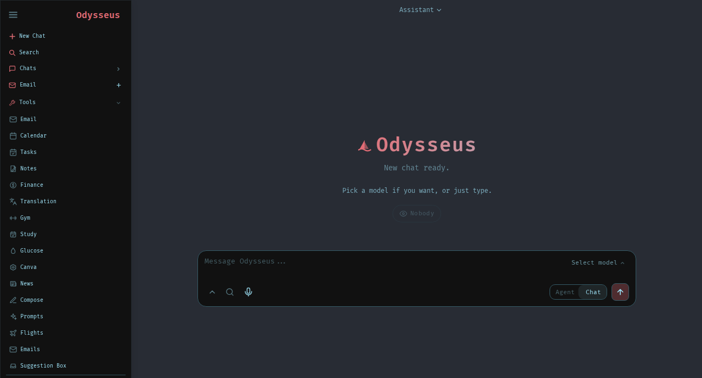
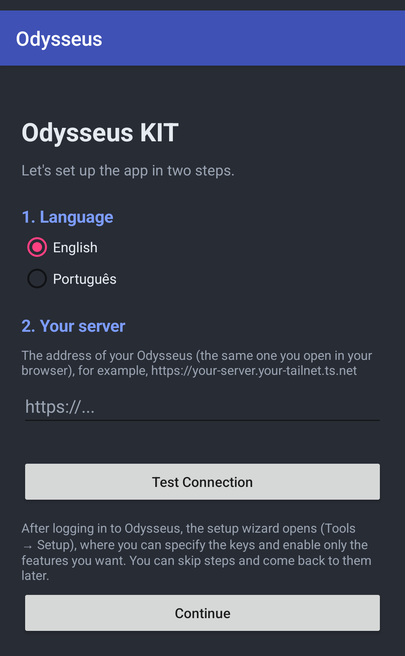
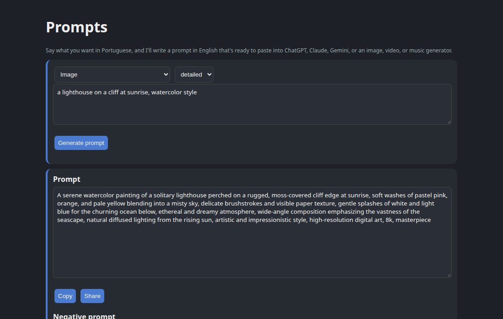
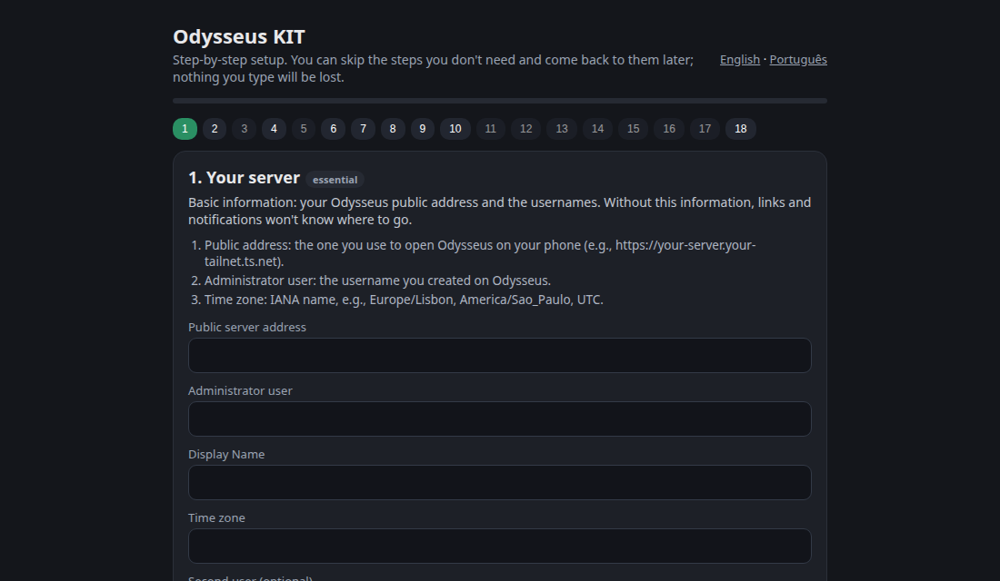

# Odysseus KIT

**English** · [Português](README.pt.md)

[](LICENSE)
[](../../releases/latest)


**A toolbox for Odysseus (your self-hosted AI chat).** It adds in-chat tools (translation, finance, gym, study, news, flights, …), a signed Android app, and a step-by-step setup assistant, so you can go from a bare Odysseus to a personal assistant in one evening.

- **Everything is optional.** Enable what you want; hide the rest in *Settings → Appearance*. Skipped tools keep their settings, so you can switch them on later.
- **Bring your own keys.** You pick the AI providers (Groq, Gemini, DeepL, Claude…) and paste your own keys. Nothing is shared with the author.
- **Private by design.** Keys stay on your server. Each person who logs in gets their own data.

<p align="center">
  
  
</p>

> **Status: pre-release.** Extracted from a personal installation and not yet tested by third parties. If something fails, please [open an issue](../../issues).

## Contents

[What's included](#whats-included) · [How it fits together](#how-it-fits-together) · [Quick start](#quick-start) · [Android app](#download-the-android-app) · [Security and privacy](#security-and-privacy) · [Troubleshooting](#troubleshooting) · [Contributing](#contributing) · [License](#license)

## What's included

### Assistant tools

| Tool | What it does | Requires |
|---|---|---|
| **Translation** | pt/en/es/fr/de/…, voice, photo translation, conversation mode, reply suggestions for guests | DeepL and/or Groq |
| **Compose** | email/WhatsApp draft with a button to pick the sending app | Groq |
| **Prompts** | describe what you want in your language and get a ready-to-paste English prompt (chat, image, code, video, music, agent), with a warning when important details are missing | Groq (Claude Haiku as fallback) |
| **News** | feed by sources and topics for each person, topic boosts, muted words, daily summary | Groq |
| **Study** | assignments with steps, sources with APA citation, link/PDF summary (with OCR for scans), Word export of references, deadline reminders, 14-day planner | Groq |
| **Emails** | connect IMAP/SMTP accounts (Gmail, Outlook, Yahoo, iCloud, custom) with servers pre-filled and a connection test | app passwords from your provider |
| **Flights** | saved flights, Flightradar24 links, live status and delay alerts | AirLabs key (optional) |
| **Canva** | create designs and export PNG | Canva developer account |
| **Idea Box** | users submit ideas/bugs, AI organizes them into tasks | Groq |

### Personal tracking

| Tool | What it does | Requires |
|---|---|---|
| **Finance** | transactions, debts with alerts, goals, photo receipts, monthly expenses | Groq (receipts) |
| **Gym + Training+** | plan, sets, rest, weight, progress photos, AI technique analysis, medical reports | Groq/Gemini |
| **Glucose** | LibreLinkUp chart and history, manual and editable log. The insulin calculator ships **disabled** | LibreLinkUp |

### Interface and platform

| Feature | What it does |
|---|---|
| **Usage bar** | slim bar above your name with Claude session/weekly limits and Groq, DeepL and AirLabs usage |
| **Choice buttons** | when the assistant needs a decision it ends its reply with `[[opcoes: Yes \| No]]` and the chat shows tap-able buttons (the `opcoes` keyword is fixed) |
| **Tool tabs** | reorder and hide tabs in *Settings → Appearance*; saved on the server, shared by browser and app |
| **Language** | English / Português switch for the tools and the app |
| **Ryoku theme** | extra theme for Odysseus and all tool pages (GPL-3.0 art from the ryoku.dev project) |
| **Setup assistant** | step-by-step wizard for keys and services, with *Test* and *Skip* on every step (admins only) |
| **Android app** | widgets, reminders with actions, native translator, calendar, quick voice task, fingerprint lock |

<p align="center"></p>

## How it fits together

```
 Phone / browser ──HTTPS──▶ your proxy (Tailscale Serve, Caddy, nginx)
                                 │
                 ┌───────────────┼────────────────┐
                 ▼               ▼                ▼
            Odysseus       KIT tools (127.0.0.1)   Scheduled jobs
        + ody-extras.js    Hub :8792 · Translate   reminders, flights,
        (tabs, theme, bar)   :8791 · Canva :8793   study deadlines
```

The Android app is a shell around **your** Odysseus: it shows whatever your server serves. The KIT tabs appear once `ody-extras.js` and the tools are installed on that server.

## Quick start

**You need:** Linux, Python 3.11+, Odysseus running in Docker, and a way to reach it over HTTPS (for example [Tailscale](https://tailscale.com)). Details in [docs/INSTALL.md](docs/INSTALL.md).

```bash
git clone https://github.com/Canoruss/odysseus-kit.git ~/odysseus-kit && cd ~/odysseus-kit
python3 -I setup/wizard.py        # opens http://127.0.0.1:8790 and guides you step by step
bash scripts/start.sh             # starts the tools
```

For each service the wizard explains what it is, where to get the key, offers a **Test** button, and lets you **skip** it. Afterwards, load `ody-extras.js` into Odysseus as described in the install guide. Inside Odysseus the same wizard lives under **Tools → Setup**.

<p align="center"></p>

| Guide | Topic |
|---|---|
| [docs/INSTALL.md](docs/INSTALL.md) | full installation, ports, proxy, `ody-extras.js` |
| [docs/APK.md](docs/APK.md) | install or build the Android app |
| [docs/I18N.md](docs/I18N.md) | languages and adding translations |
| [docs/GLUCOSE.md](docs/GLUCOSE.md) | glucose tool and insulin calculator setup |

## Download the Android app

No compiling needed: the signed APK is in **[Releases](../../releases/latest)** (`Odysseus-KIT-<version>.apk`).

1. Download it on your phone and install it (allow "install unknown apps" when Android asks).
2. Open it, choose a language, enter your Odysseus address and tap **Test connection**.
3. Log in and follow **Tools → Setup**.

Verify the download first: the release notes list the file's `SHA-256` and the signing certificate fingerprint (`sha256sum`, `apksigner verify --print-certs`). The app requires your own Odysseus server.

## Security and privacy

- Keys live only in `~/.config/odysseus-kit/*.env` (mode 600), never in the repository.
- Tools listen on `127.0.0.1` only. Publish them behind your proxy **with the same authentication as Odysseus**.
- AI features send text, audio or photos to the provider you choose (Groq, Gemini, DeepL…). Read their policies.
- Run `python3 scripts/scan.py` before publishing changes: it looks for secrets and personal data.

## Known limitations

- Pre-release, from a single installation: expect rough edges, especially on a fresh install.
- Some texts and defaults are Portuguese-first (certain news sources, `pt-PT` replies; reading SNS 24 SMS only works in Portugal).
- The Android app has only been tried on one phone and an emulator. Fastest dictation uses Google's speech recognizer; without it the app records and your server transcribes.
- Keys are entered in the wizard on the server; the app itself never asks for them.
- Free AI tiers have limits and can be slow or return errors at busy times.

## Health disclaimer

Glucose, Gym and medical reports are **support tools, not medical advice**. The insulin calculator ships without values and only works if you enter your doctor's values, at your own risk. See [docs/GLUCOSE.md](docs/GLUCOSE.md).

## Troubleshooting

| Symptom | Check |
|---|---|
| Tool tabs don't show in Odysseus | `ody-extras.js` is loaded in `index.html`; hard-refresh (Ctrl+F5 twice); in the app, close and reopen it |
| Tab opens blank or shows 502 | the tool isn't running: `bash scripts/start.sh`, then check the port table in the install guide |
| A tool says a key is missing | open **Tools → Setup**, enter the key and press **Test** |
| App can't connect | the address must be HTTPS and reachable from the phone (is Tailscale on?) |
| Page text is in the wrong language | *Settings → Appearance → Tools language* |

## Contributing

Issues and pull requests are welcome. Please run `python3 scripts/scan.py` before opening a PR, keep personal data out of commits, and add both English and Portuguese strings (see [docs/I18N.md](docs/I18N.md)).

## License

[AGPL-3.0](LICENSE), the same as Odysseus, of which this project is a derivative work. If you modify it and offer it as a service over a network, you must share your code. Attributions in [NOTICE.md](NOTICE.md).
