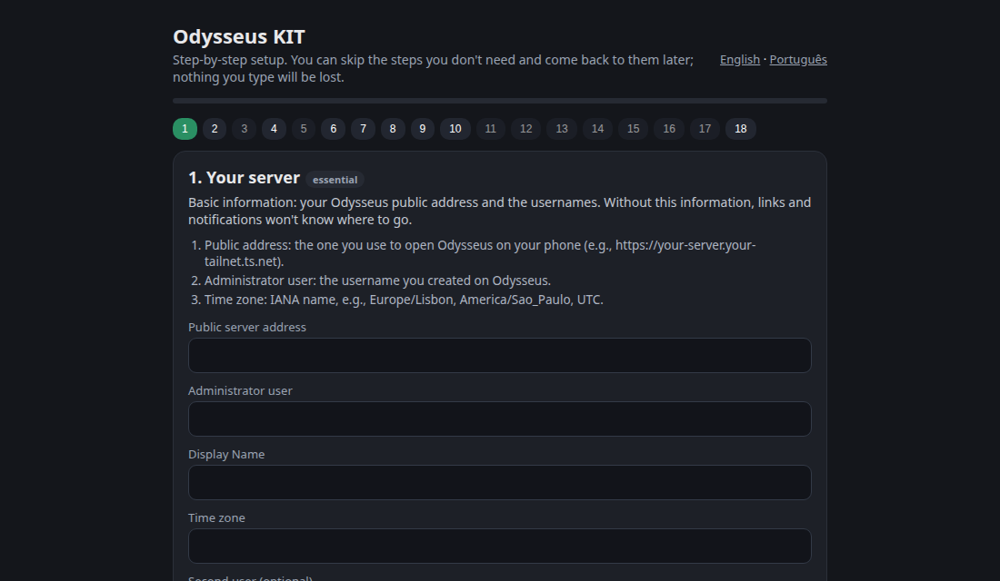
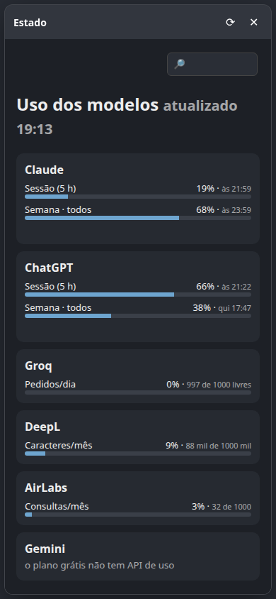
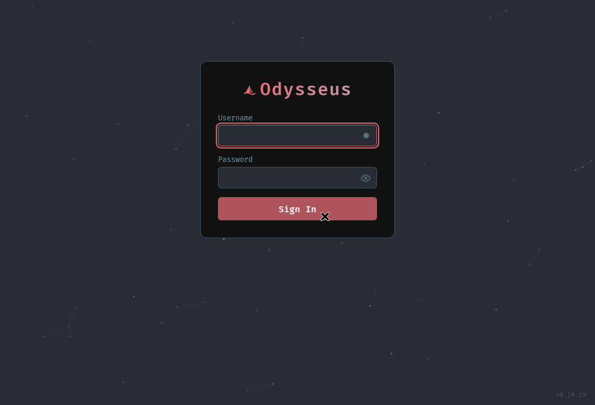
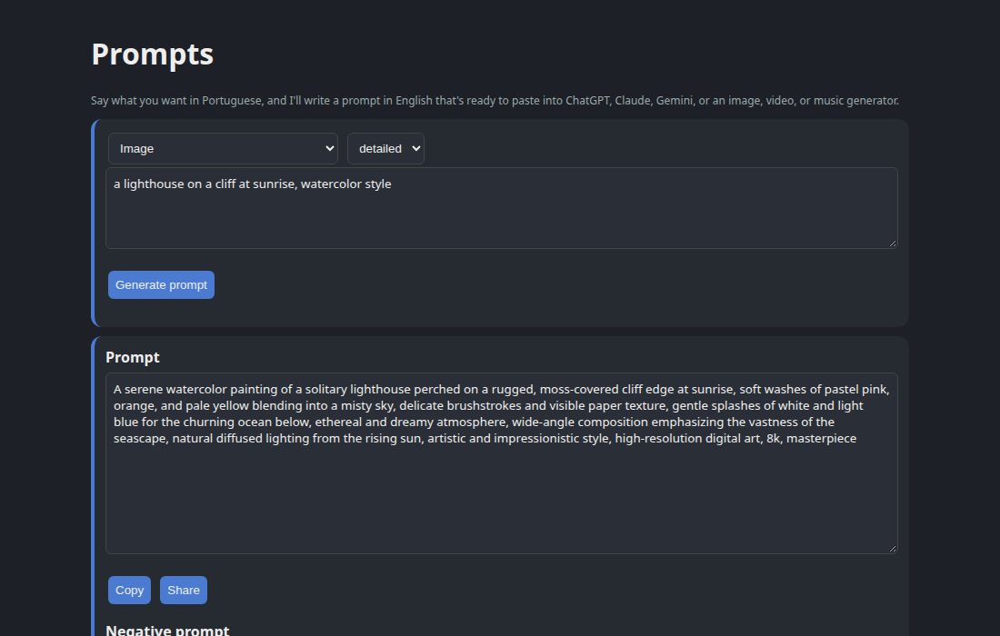
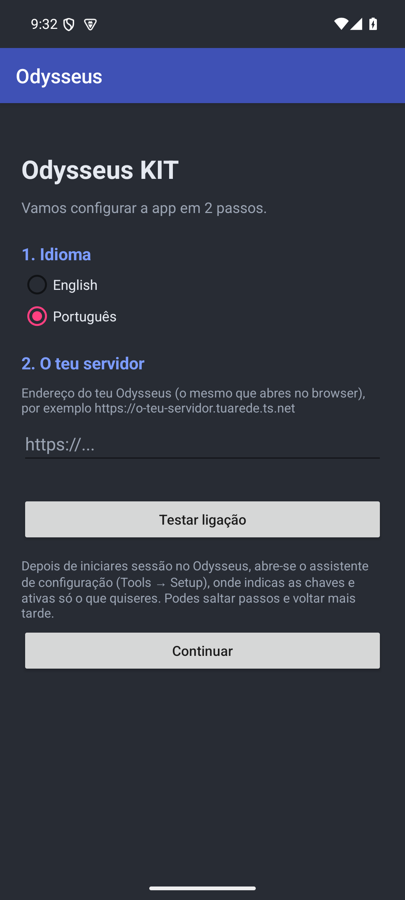
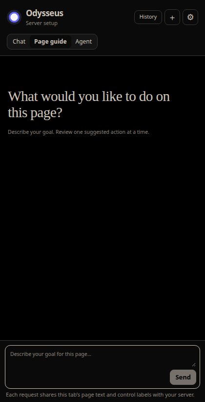

# Odysseus KIT

[English](README.md) · **Português**

[](LICENSE)
[](../../releases)


<p align="center"></p>

**O teu assistente de IA, no teu próprio servidor.** Ferramentas para o servidor, apps para Windows, Linux e Android e uma extensão para o navegador, tudo num só kit: chat, tarefas, tradução, finanças e mais.

> **Estado:** pré-lançamento. Os downloads abaixo são as últimas versões publicadas e correspondem ao código deste repositório.

## Descarregar

| | App | Versão | Download |
|---|---|---|---|
| 🪟 | **Windows** | 0.3.5 | [Instalador (.exe)](https://github.com/Canoruss/odysseus-kit/releases/download/apps-0.3.5-android-1.55/Odysseus_0.3.5_x64-setup.exe) |
| 🐧 | **Linux** | 0.3.5 | [AppImage](https://github.com/Canoruss/odysseus-kit/releases/download/apps-0.3.5-android-1.55/Odysseus_0.3.5_amd64.AppImage) · [.deb](https://github.com/Canoruss/odysseus-kit/releases/download/apps-0.3.5-android-1.55/Odysseus_0.3.5_amd64.deb) |
| 🤖 | **Android** | 1.58 | [Odysseus-1.58.apk](https://github.com/Canoruss/odysseus-kit/releases/download/android-v1.58/Odysseus-1.58.apk) · [SHA-256](https://github.com/Canoruss/odysseus-kit/releases/download/android-v1.58/SHA256SUMS) |
| 🧩 | **Extensão Chrome / Edge** | 0.13.1 | [ZIP](https://github.com/Canoruss/odysseus-kit/releases/download/apps-0.3.5-android-1.55/odysseus-extension-0.13.1.zip) · [guia](docs/EXTENSION.pt.md) |
| 🖥️ | **Ferramentas do servidor (KIT)** | 1.7.1 | [Última release](../../releases/latest) · [instalação](docs/INSTALL.pt.md) |

As apps ligam-se ao **teu** servidor Odysseus; não o substituem. Ainda não tens servidor? Segue o [guia gratuito para a cloud](docs/ORACLE.pt.md) ou [instala num servidor existente](docs/INSTALL.pt.md).

## Começar em 4 passos

1. **Prepara um servidor:** [guia para a cloud](docs/ORACLE.pt.md) ou [servidor existente](docs/INSTALL.pt.md).
2. **Instala uma app** da tabela acima.
3. **Liga-te:** escreve o endereço do servidor e inicia sessão (o dispositivo tem de conseguir chegar ao servidor).
4. **Adiciona serviços opcionais** no assistente de configuração. Custos e limites gratuitos variam conforme o fornecedor.

## Conhece a interface

| Chat e ferramentas | Assistente de configuração |
|---|---|
|  |  |
| Conversa e escolhe as ferramentas que precisas. | Configura serviços opcionais passo a passo. |

| Janela Estado (nova) | App de computador |
|---|---|
|  |  |
| Uso dos modelos num relance; o dono do servidor vê também disco, RAM, CPU e saúde. | Cliente para Windows e Linux com ícone na bandeja e atualização automática. |

| Ferramenta de prompts | App Android |
|---|---|
|  |  |
| Transforma uma ideia num prompt. | Widgets, lembretes, tradutor, voz, bloqueio por impressão digital e um agente no telemóvel que pergunta antes de ações sensíveis. |

### Extensão do browser

<p align="center"></p>

Painel lateral com Chat, Guia da página e modo Agente.

## Novidades

- **Aba Estado** (KIT 1.7.1): janela flutuante com o uso dos modelos para todos; disco, RAM, swap, CPU, contentores e backups para o dono.
- **Android 1.58**: voz e política em Rust, agente que confirma ações sensíveis. Código em [`android/`](android/) e [`voice-core/`](voice-core/).
- **Desktop 0.3.5**: versão testada em Windows, com menu na bandeja e atualização automática. Código em [`desktop/`](desktop/).
- **Extensão 0.13.1**: Guia da página, modo agente e histórico. Código em [`extension/`](extension/).

[Funcionalidades](#o-que-inclui) · [Instalação](#início-rápido) · [Extensão](docs/EXTENSION.pt.md) · [Guia de utilização](docs/GUIDE.pt.md) · [Segurança](#segurança-e-privacidade)

## O que inclui

<details open>
<summary><b>Ferramentas do assistente</b></summary>

| Ferramenta | O que faz | Precisa de |
|---|---|---|
| **Tradução** | pt/en/es/fr/de/…, voz, tradução por foto, modo conversa, sugestões de resposta a hóspedes | DeepL and/or Groq |
| **Compose** | rascunho de email/WhatsApp com botão para escolher a app de envio | Groq |
| **Prompts** | descreves o que queres na tua língua e recebes um prompt em inglês pronto a colar (chat, imagem, código, vídeo, música, agente), com aviso quando faltam detalhes importantes | Groq (Claude Haiku de reserva) |
| **Notícias** | feed estilo revista (notícia em destaque + cartões com imagem), fontes e temas por pessoa, temas que sobem, palavras silenciadas, filtro «só críticas», resumo diário neutro | Groq |
| **Estudo** | trabalhos com etapas, fontes com citação APA, resumo de links/PDF (com OCR para digitalizações), exportar referências para Word, avisos de prazos, planeador de 14 dias | Groq |
| **Emails** | liga contas IMAP/SMTP (Gmail, Outlook, Yahoo, iCloud, outras) com os servidores preenchidos e teste de ligação. **Faturas detetadas no e-mail** (`/finance/bills`): uma procura diária ou à pedido lê o correio recente (no Gmail, «Todo o correio», por isso inclui os separadores) e as primeiras páginas dos PDFs em anexo; o Groq extrai emissor, valor, vencimento e referência e tu **confirmas ou ignoras** cada uma. Confirmar cria uma dívida nas Finanças. Avisos de pagamento falhado (devolução bancária, suspensão) aparecem como alerta. Os remetentes que confirmas são aprendidos; os que ignoras duas vezes deixam de ser analisados. Só se guarda o ID da mensagem e os campos extraídos, nunca o corpo do e-mail | palavras-passe de aplicação do teu fornecedor; Groq |
| **Voos** | voos guardados e agrupados em Hoje / Próximos / Passados, contagem decrescente até à partida, etiqueta de estado (atraso, aterrou, cancelado), ligações ao Flightradar24 / FlightAware, avisos de atraso e de porta, mensagem para copiar e enviar ao hóspede | chave AirLabs (opcional) |
| **Canva** | criar designs e exportar PNG | conta de programador do Canva |
| **Caixa de ideias** | os utilizadores enviam ideias/bugs (texto e capturas) e a IA organiza-os em tarefas | Groq (visão), Gemini de reserva |

</details>

<details open>
<summary><b>Acompanhamento pessoal</b></summary>

| Ferramenta | O que faz | Precisa de |
|---|---|---|
| **Finanças** | movimentos, dívidas com alertas, metas, talões por foto, despesas mensais. **Faturas recorrentes**: marca uma fatura confirmada como mensal e recebes lembrete na véspera e no dia do vencimento, um «venceu ontem, já pagaste?» no dia seguinte e um aviso 3 dias antes da data habitual se a fatura ainda não chegou. «Já paguei» remove a dívida correspondente | Groq (talões, faturas) |
| **Gym + Treino+** | plano, séries com esforço (RPE), temporizador de descanso, peso corporal e meta, fotos de progresso, análise de técnica por IA, relatórios médicos. **Treino+**: recordes pessoais automáticos, sugestões de progressão (regra de +2,5%), séries por semana por grupo muscular (alvo 10–20), calculadora de discos, 1RM estimado, notas por exercício Um **cartão de saúde** mostra frequência cardíaca, passos e sono de um relógio com Health Connect (sincronização Android). | Groq/Gemini |
| **Glicose** | gráfico e histórico do LibreLinkUp, registo manual e editável. **Análise** a 7/14/30 dias: tempo no alvo (5 zonas com as metas internacionais), média, GMI, variabilidade (CV), perfil diário (AGP) com mediana e faixas de percentis, padrões por hora do dia, imprimir/PDF e copiar resumo para o médico. A calculadora de insulina vem **desativada** | LibreLinkUp |
| **Ciclo** | período, fluxo, sintomas, humor, temperatura basal, testes de ovulação; previsões com janela fértil, ovulação e TPM; cartão da fase com anel do ciclo e ilustrações, o **Pingo**, pinguim guia animado (17 estados, animação por camadas), chat "Pergunta ao Pingo", questionário de perfil, dicas por fase, gráficos de estatísticas, lembrete da pílula, lembretes, exportação CSV/JSON, PIN opcional, tema claro/escuro e paletas de cores, dados separados por conta; uma **caixa do ciclo no Ginásio** ajusta as dicas de treino e dieta à fase | Groq/Gemini (opcional, para o Pergunta ao Pingo) |
| **Foco** | tarefas e rotinas para TDAH/autismo: passos pequenos, temporizadores, uma coisa de cada vez; usa a Caixa de ideias | nada |
| **Jogos grátis** | lista de jogos grátis neste momento, com data de fim e preço, e avisos opcionais quando aparece um novo, **por loja** (Epic, Steam, GOG, itch.io, Prime) | nenhum |
| **Sonhos** | diário de sonhos por conta (texto ou voz), interpretação por IA com guia estilo psicologia, temas recorrentes e estado de espírito | Groq |

</details>

<details open>
<summary><b>Interface e plataforma</b></summary>

| Funcionalidade | O que faz |
|---|---|
| **Pesquisa global** | uma caixa 🔎 em cada página das ferramentas pesquisa só nos teus dados (Foco, Sonhos, Estudo, Contas, Finanças; Caixa de ideias para o administrador) | nenhum |
| **Horas de silêncio** | período de silêncio por conta (abas Foco e Ciclo): os lembretes automáticos não urgentes esperam pelo fim; avisos de voo e pílula passam sempre | nenhum |
| **Private Browser** | Chromium opcional que o assistente controla, com capturas, extração de produtos/preços, perfis de login separados, proteção de compras e **vista ao vivo com controlo remoto** para o administrador (`tools/pbrowse`) | Node.js + Playwright |
| **Extensão do browser** | painel lateral Chrome/Edge: chat com contexto da página e de separadores, Guia da página, modo agente e histórico (`extension/`) | um token de API do Odysseus |
| **Barra de uso** | barra fina por cima do teu nome com os limites de sessão/semana do Claude e o uso do Groq, DeepL e AirLabs |
| **Botões de escolha** | quando o assistente precisa de uma decisão termina a resposta com `[[opcoes: Sim \| Não]]` e o chat mostra botões (a palavra `opcoes` é fixa) |
| **Abas das Tools** | ordenar e esconder abas em *Settings → Appearance*; guardado no servidor, partilhado pelo browser e pela app |
| **Idioma** | seletor English / Português para as ferramentas e a app |
| **Tema Ryoku** | tema extra para o Odysseus e todas as páginas das ferramentas (arte GPL-3.0 do projeto ryoku.dev) |
| **Assistente de configuração** | passo a passo para chaves e serviços, com *Testar* e *Saltar* em cada passo (só administradores) |
| **Lembretes e tarefas agendadas** | scripts agendados (cron) que criam lembretes no Odysseus: prestações e despesas, dívidas, prazos de estudo, atrasos de voos, período/ovulação, treinos, lista diária do ClickUp, sincronização da galeria, avisos de jogos grátis, lembrete da pílula, **procura e lembretes de faturas**, **avisos de eventos em falta no calendário** (eventos mencionados no e-mail que não estão no calendário), **scan noturno** (verifica serviços, contentores e páginas das ferramentas; um modelo Groq gratuito opcional resume as falhas; alerta no Telegram só se houver falhas) |
| **Patches ao núcleo** | opcionais: modelo **Auto** no seletor (rápido vs raciocínio), parâmetros por defeito, persona base, auditoria de memórias em lotes, menos ruído nos registos de email; aplicados pelo instalador, tudo ou nada, ver `patches/README.md` |
| **App Android** | widgets, lembretes com ações, tradutor nativo, calendário, tarefa rápida por voz, bloqueio por impressão digital |

<p align="center"></p>

</details>

## Como se liga tudo

```
 Telemóvel / browser ──HTTPS──▶ o teu proxy (Tailscale Serve, Caddy, nginx)
                                 │
                 ┌───────────────┼────────────────┐
                 ▼               ▼                ▼
            Odysseus       KIT tools (127.0.0.1)   Tarefas agendadas
        + ody-extras.js    Hub :8792 · Translate   lembretes, voos,
        (abas, tema, barra)  :8791 · Canva :8793   prazos de estudo
```

A app Android é uma casca à volta do **teu** Odysseus: mostra o que o teu servidor servir. As abas do KIT aparecem depois de instalares o `ody-extras.js` e as ferramentas nesse servidor.

## Escolher como usar o Odysseus (4 opções)

| # | Opção | O que recebe | Onde |
|---|---|---|---|
| 1 | **App Windows (.exe)** | Cliente de computador com assistente («tenho servidor» / «não tenho»), ícone na bandeja, atualização automática | [Release 0.3.5](https://github.com/Canoruss/odysseus-kit/releases/tag/apps-0.3.5-android-1.55) |
| 2 | **App Linux (.AppImage / .deb)** | O mesmo cliente para Linux | [Release 0.3.5](https://github.com/Canoruss/odysseus-kit/releases/tag/apps-0.3.5-android-1.55) |
| 3 | **App Android (.apk)** | Cliente móvel, atualizações dentro da app | [Android 1.58](../../releases/tag/android-v1.58) / [docs/APK.pt.md](docs/APK.pt.md) |
| 4 | **Instalação por script num servidor cloud** | Odysseus + KIT completos num só comando (Oracle Always Free, qualquer VPS Ubuntu/Debian) | [Início rápido](#início-rápido) |

As apps precisam de um servidor Odysseus (opção 4, ou o seu). O código do cliente de computador está em [`desktop/`](desktop/); para correr o instalador no seu PC use `install/install.sh --local`. As ações do desktop (atualizar, recarregar, mudar servidor) estão em **Definições → Sistema → Odysseus Desktop** e no menu da bandeja.

## Início rápido

### Opção A: servidor gratuito com um comando (Oracle Cloud Always Free)

Cria uma VM Ubuntu no plano gratuito da Oracle, abre as portas 80 e 443 e corre:

```bash
git clone https://github.com/Canoruss/odysseus-kit.git ~/odysseus-kit && bash ~/odysseus-kit/install/install.sh
```

Instala o Docker, o Odysseus 1.0.2, as ferramentas do KIT, os patches opcionais e o HTTPS (Caddy + sslip.io), e no fim mostra o teu endereço e a palavra-passe de administrador. O `uninstall.sh` remove tudo. Passo a passo com o que clicar: [docs/ORACLE.pt.md](docs/ORACLE.pt.md). O script nunca contacta o servidor do autor e não envia telemetria.

### Opção B: já tens o Odysseus a correr

**Precisas de:** Linux, Python 3.11+, Odysseus a correr em Docker e uma forma de lhe chegar por HTTPS (por exemplo [Tailscale](https://tailscale.com)). Detalhes em [docs/INSTALL.pt.md](docs/INSTALL.pt.md).

```bash
git clone https://github.com/Canoruss/odysseus-kit.git ~/odysseus-kit && cd ~/odysseus-kit
python3 -I setup/wizard.py        # abre http://127.0.0.1:8790 e guia-te passo a passo
bash scripts/start.sh             # arranca as ferramentas
```

Para cada serviço o assistente explica o que é, onde obter a chave, tem um botão **Testar** e deixa-te **saltar**. Depois, liga o `ody-extras.js` ao Odysseus como descrito no guia de instalação. Dentro do Odysseus o mesmo assistente está em **Tools → Setup**.

<p align="center"></p>

| Guia | Tema |
|---|---|
| [docs/INSTALL.pt.md](docs/INSTALL.pt.md) | instalação completa, portas, proxy, `ody-extras.js` |
| [docs/ORACLE.pt.md](docs/ORACLE.pt.md) | servidor grátis no Oracle Cloud com um só comando (`install/install.sh`) |
| [docs/APK.md](docs/APK.pt.md) | instalar ou compilar a app Android |
| [docs/I18N.md](docs/I18N.pt.md) | idiomas e como acrescentar traduções |
| [docs/GLUCOSE.md](docs/GLUCOSE.pt.md) | ferramenta de glicose e calculadora de insulina |

## Extensão do browser

Um painel lateral para Chrome/Edge que fala com o teu servidor: chat com a página atual ou até três separadores, um **Guia da página** passo a passo (cada ação precisa da tua aprovação), um **modo agente** e histórico pesquisável. Instalação, privacidade e problemas comuns: **[docs/EXTENSION.pt.md](docs/EXTENSION.pt.md)**. Instruções do dia a dia de cada ferramenta: **[docs/GUIDE.pt.md](docs/GUIDE.pt.md)**.

## Descarregar a app Android

Não precisas de compilar: descarrega a **[Odysseus-1.58.apk](https://github.com/Canoruss/odysseus-kit/releases/download/android-v1.58/Odysseus-1.58.apk)** ([SHA-256](https://github.com/Canoruss/odysseus-kit/releases/download/android-v1.58/SHA256SUMS)). O código-fonte e o guia de compilação estão em [`android/`](android/) e [docs/APK.pt.md](docs/APK.pt.md).

1. Descarrega-a no telemóvel e instala-a (permite "instalar apps desconhecidas" quando o Android pedir).
2. Abre-a, escolhe o idioma, escreve o endereço do teu Odysseus e toca em **Testar ligação**.
3. Inicia sessão e segue **Tools → Setup**.

A app precisa do teu próprio servidor Odysseus. As atualizações Android dependem do servidor configurado; não vêm necessariamente do GitHub.

## Segurança e privacidade

- As chaves ficam só em `~/.config/odysseus-kit/*.env` (modo 600), nunca no repositório.
- As ferramentas escutam só em `127.0.0.1`. Publica-as atrás do teu proxy **com a mesma autenticação do Odysseus**.
- As funções com fotos (capturas da Caixa de ideias, fotos de progresso/técnica do Gym) tentam primeiro a visão da Groq e caem para o Gemini; o vídeo fica no Gemini.
- As funções de IA enviam texto, áudio ou fotos ao fornecedor que escolheres (Groq, Gemini, DeepL…). Lê as políticas deles.
- Corre `python3 scripts/scan.py` antes de publicar alterações: procura segredos e dados pessoais.

## Limitações conhecidas

- Pré-lançamento, vindo de uma única instalação: esperam-se arestas, sobretudo numa instalação nova.
- Alguns textos e predefinições são primeiro em português (certas fontes de notícias, respostas em `pt-PT`; a leitura de SMS do SNS 24 só serve em Portugal).
- A app Android só foi experimentada num telemóvel e num emulador. O ditado mais rápido usa o reconhecedor de voz da Google; sem ele, a app grava e o teu servidor transcreve.
- As chaves introduzem-se no assistente, no servidor; a app nunca as pede.
- Os planos gratuitos de IA têm limites e podem ser lentos ou dar erros nas horas de maior uso.

## Aviso de saúde

Glicose, Gym e relatórios médicos são **ferramentas de apoio, não aconselhamento médico**. A calculadora de insulina vem sem valores e só funciona se introduzires os valores do teu médico, por tua conta e risco. Ver [docs/GLUCOSE.md](docs/GLUCOSE.pt.md).

## Problemas comuns

| Sintoma | Verifica |
|---|---|
| As abas não aparecem no Odysseus | o `ody-extras.js` está ligado no `index.html`; Ctrl+F5 duas vezes; na app, fecha e reabre |
| A aba abre vazia ou dá 502 | a ferramenta não está a correr: `bash scripts/start.sh` e vê a tabela de portas no guia |
| Uma ferramenta diz que falta uma chave | abre **Tools → Setup**, escreve a chave e carrega em **Testar** |
| A app não liga | o endereço tem de ser HTTPS e acessível do telemóvel (o Tailscale está ligado?) |
| O texto da página está no idioma errado | *Settings → Appearance → Idioma das ferramentas* |

## Contribuir

Issues e pull requests são bem-vindos. Corre `python3 scripts/scan.py` antes de abrir um PR, não incluas dados pessoais nos commits e acrescenta os textos em inglês e português (ver [docs/I18N.pt.md](docs/I18N.pt.md)).

## Licença

[AGPL-3.0](LICENSE), a mesma do Odysseus, de que este projeto é um trabalho derivado. Se o modificares e o ofereceres como serviço em rede, tens de partilhar o código. Atribuições em [NOTICE.md](NOTICE.md).
