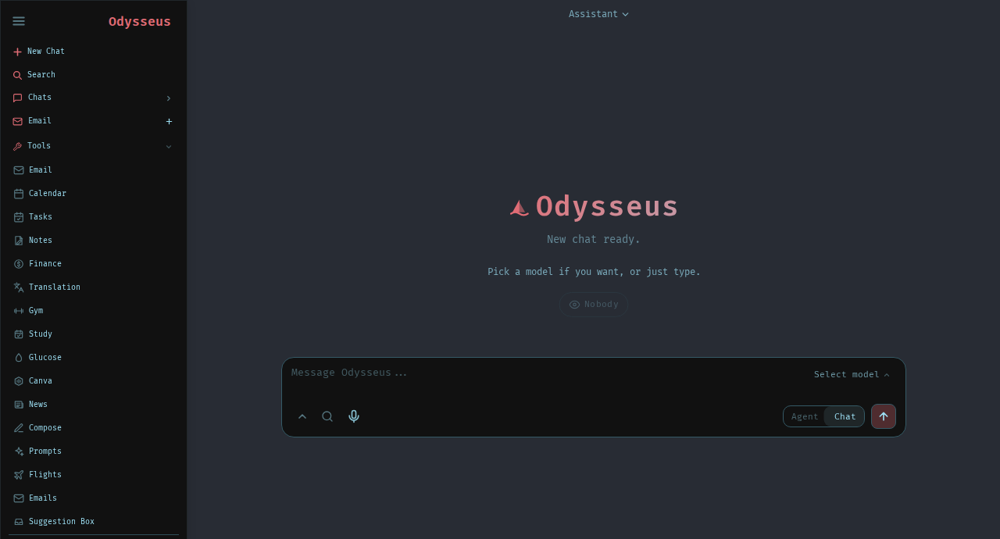
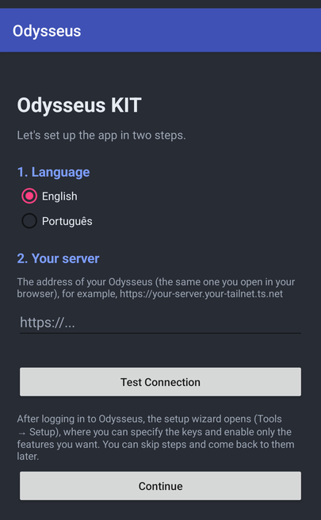

# Odysseus KIT

[English](README.md) · **Português**

[](LICENSE)
[](../../releases/latest)


**Uma caixa de ferramentas para o Odysseus (o teu chat de IA self-hosted).** Acrescenta ferramentas dentro do chat (tradução, finanças, ginásio, estudo, notícias, voos, …), uma app Android assinada e um assistente de configuração passo a passo, para passares de um Odysseus simples a um assistente pessoal numa noite.

- **Tudo é opcional.** Ativa o que queres e esconde o resto em *Settings → Appearance*. As ferramentas que saltares guardam a configuração, e podes ativá-las mais tarde.
- **Trazes as tuas chaves.** Escolhes os fornecedores de IA (Groq, Gemini, DeepL, Claude…) e colas as tuas chaves. Nada é partilhado com o autor.
- **Privado por desenho.** As chaves ficam no teu servidor. Cada pessoa com sessão iniciada tem os seus dados.

<p align="center">
  
  
</p>

> **Estado: pré-lançamento.** Extraído de uma instalação pessoal e ainda não testado por terceiros. Se algo falhar, [abre uma issue](../../issues).

## Índice

[O que inclui](#o-que-inclui) · [Como se liga tudo](#como-se-liga-tudo) · [Início rápido](#início-rápido) · [App Android](#descarregar-a-app-android) · [Segurança e privacidade](#segurança-e-privacidade) · [Problemas comuns](#problemas-comuns) · [Contribuir](#contribuir) · [Licença](#licença)

## O que inclui

### Ferramentas do assistente

| Ferramenta | O que faz | Precisa de |
|---|---|---|
| **Tradução** | pt/en/es/fr/de/…, voz, tradução por foto, modo conversa, sugestões de resposta a hóspedes | DeepL and/or Groq |
| **Compose** | rascunho de email/WhatsApp com botão para escolher a app de envio | Groq |
| **Prompts** | descreves o que queres na tua língua e recebes um prompt em inglês pronto a colar (chat, imagem, código, vídeo, música, agente), com aviso quando faltam detalhes importantes | Groq (Claude Haiku de reserva) |
| **Notícias** | feed por fontes e temas para cada pessoa, temas que sobem, palavras silenciadas, resumo diário | Groq |
| **Estudo** | trabalhos com etapas, fontes com citação APA, resumo de links/PDF (com OCR para digitalizações), exportar referências para Word, avisos de prazos, planeador de 14 dias | Groq |
| **Emails** | liga contas IMAP/SMTP (Gmail, Outlook, Yahoo, iCloud, outras) com os servidores preenchidos e teste de ligação | palavras-passe de aplicação do teu fornecedor |
| **Voos** | voos guardados, ligações ao Flightradar24, estado em tempo real e avisos de atraso | chave AirLabs (opcional) |
| **Canva** | criar designs e exportar PNG | conta de programador do Canva |
| **Caixa de ideias** | os utilizadores enviam ideias/bugs e a IA organiza-os em tarefas | Groq |

### Acompanhamento pessoal

| Ferramenta | O que faz | Precisa de |
|---|---|---|
| **Finanças** | movimentos, dívidas com alertas, metas, talões por foto, despesas mensais | Groq (talões) |
| **Gym + Treino+** | plano, séries, descanso, peso, fotos de progresso, análise de técnica por IA, relatórios médicos | Groq/Gemini |
| **Glicose** | gráfico e histórico do LibreLinkUp, registo manual e editável. A calculadora de insulina vem **desativada** | LibreLinkUp |

### Interface e plataforma

| Funcionalidade | O que faz |
|---|---|
| **Barra de uso** | barra fina por cima do teu nome com os limites de sessão/semana do Claude e o uso do Groq, DeepL e AirLabs |
| **Botões de escolha** | quando o assistente precisa de uma decisão termina a resposta com `[[opcoes: Sim \| Não]]` e o chat mostra botões (a palavra `opcoes` é fixa) |
| **Abas das Tools** | ordenar e esconder abas em *Settings → Appearance*; guardado no servidor, partilhado pelo browser e pela app |
| **Idioma** | seletor English / Português para as ferramentas e a app |
| **Tema Ryoku** | tema extra para o Odysseus e todas as páginas das ferramentas (arte GPL-3.0 do projeto ryoku.dev) |
| **Assistente de configuração** | passo a passo para chaves e serviços, com *Testar* e *Saltar* em cada passo (só administradores) |
| **Patches ao núcleo** | opcionais: modelo **Auto** no seletor (rápido vs raciocínio), parâmetros por defeito, persona base, auditoria de memórias em lotes, menos ruído nos registos de email; aplicados pelo instalador, tudo ou nada, ver `patches/README.md` |
| **App Android** | widgets, lembretes com ações, tradutor nativo, calendário, tarefa rápida por voz, bloqueio por impressão digital |

<p align="center"></p>

## Como se liga tudo

```
 Telemóvel / browser ──HTTPS──▶ o teu proxy (Tailscale Serve, Caddy, nginx)
                                 │
                 ┌───────────────┼────────────────┐
                 ▼               ▼                ▼
            Odysseus       KIT tools (127.0.0.1)   Tarefas agendadas
        + ody-extras.js    Hub :8792 · Translate   lembretes, voos,
        (abas, tema, barra)  :8791 · Canva :8793   prazos de estudo
```

A app Android é uma casca à volta do **teu** Odysseus: mostra o que o teu servidor servir. As abas do KIT aparecem depois de instalares o `ody-extras.js` e as ferramentas nesse servidor.

## Início rápido

**Precisas de:** Linux, Python 3.11+, Odysseus a correr em Docker e uma forma de lhe chegar por HTTPS (por exemplo [Tailscale](https://tailscale.com)). Detalhes em [docs/INSTALL.pt.md](docs/INSTALL.pt.md).

```bash
git clone https://github.com/Canoruss/odysseus-kit.git ~/odysseus-kit && cd ~/odysseus-kit
python3 -I setup/wizard.py        # abre http://127.0.0.1:8790 e guia-te passo a passo
bash scripts/start.sh             # arranca as ferramentas
```

Para cada serviço o assistente explica o que é, onde obter a chave, tem um botão **Testar** e deixa-te **saltar**. Depois, liga o `ody-extras.js` ao Odysseus como descrito no guia de instalação. Dentro do Odysseus o mesmo assistente está em **Tools → Setup**.

<p align="center"></p>

| Guia | Tema |
|---|---|
| [docs/INSTALL.pt.md](docs/INSTALL.pt.md) | instalação completa, portas, proxy, `ody-extras.js` |
| [docs/ORACLE.pt.md](docs/ORACLE.pt.md) | servidor grátis no Oracle Cloud com um só comando (`install/install.sh`) |
| [docs/APK.md](docs/APK.pt.md) | instalar ou compilar a app Android |
| [docs/I18N.md](docs/I18N.pt.md) | idiomas e como acrescentar traduções |
| [docs/GLUCOSE.md](docs/GLUCOSE.pt.md) | ferramenta de glicose e calculadora de insulina |

## Descarregar a app Android

Não precisas de compilar: a APK assinada está em **[Releases](../../releases/latest)** (`Odysseus-KIT-<versão>.apk`).

1. Descarrega-a no telemóvel e instala-a (permite "instalar apps desconhecidas" quando o Android pedir).
2. Abre-a, escolhe o idioma, escreve o endereço do teu Odysseus e toca em **Testar ligação**.
3. Inicia sessão e segue **Tools → Setup**.

Verifica primeiro o ficheiro: as notas da release indicam o `SHA-256` e a impressão do certificado de assinatura (`sha256sum`, `apksigner verify --print-certs`). A app precisa do teu próprio servidor Odysseus.

## Segurança e privacidade

- As chaves ficam só em `~/.config/odysseus-kit/*.env` (modo 600), nunca no repositório.
- As ferramentas escutam só em `127.0.0.1`. Publica-as atrás do teu proxy **com a mesma autenticação do Odysseus**.
- As funções de IA enviam texto, áudio ou fotos ao fornecedor que escolheres (Groq, Gemini, DeepL…). Lê as políticas deles.
- Corre `python3 scripts/scan.py` antes de publicar alterações: procura segredos e dados pessoais.

## Limitações conhecidas

- Pré-lançamento, vindo de uma única instalação: esperam-se arestas, sobretudo numa instalação nova.
- Alguns textos e predefinições são primeiro em português (certas fontes de notícias, respostas em `pt-PT`; a leitura de SMS do SNS 24 só serve em Portugal).
- A app Android só foi experimentada num telemóvel e num emulador. O ditado mais rápido usa o reconhecedor de voz da Google; sem ele, a app grava e o teu servidor transcreve.
- As chaves introduzem-se no assistente, no servidor; a app nunca as pede.
- Os planos gratuitos de IA têm limites e podem ser lentos ou dar erros nas horas de maior uso.

## Aviso de saúde

Glicose, Gym e relatórios médicos são **ferramentas de apoio, não aconselhamento médico**. A calculadora de insulina vem sem valores e só funciona se introduzires os valores do teu médico, por tua conta e risco. Ver [docs/GLUCOSE.md](docs/GLUCOSE.pt.md).

## Problemas comuns

| Sintoma | Verifica |
|---|---|
| As abas não aparecem no Odysseus | o `ody-extras.js` está ligado no `index.html`; Ctrl+F5 duas vezes; na app, fecha e reabre |
| A aba abre vazia ou dá 502 | a ferramenta não está a correr: `bash scripts/start.sh` e vê a tabela de portas no guia |
| Uma ferramenta diz que falta uma chave | abre **Tools → Setup**, escreve a chave e carrega em **Testar** |
| A app não liga | o endereço tem de ser HTTPS e acessível do telemóvel (o Tailscale está ligado?) |
| O texto da página está no idioma errado | *Settings → Appearance → Idioma das ferramentas* |

## Contribuir

Issues e pull requests são bem-vindos. Corre `python3 scripts/scan.py` antes de abrir um PR, não incluas dados pessoais nos commits e acrescenta os textos em inglês e português (ver [docs/I18N.pt.md](docs/I18N.pt.md)).

## Licença

[AGPL-3.0](LICENSE), a mesma do Odysseus, de que este projeto é um trabalho derivado. Se o modificares e o ofereceres como serviço em rede, tens de partilhar o código. Atribuições em [NOTICE.md](NOTICE.md).
